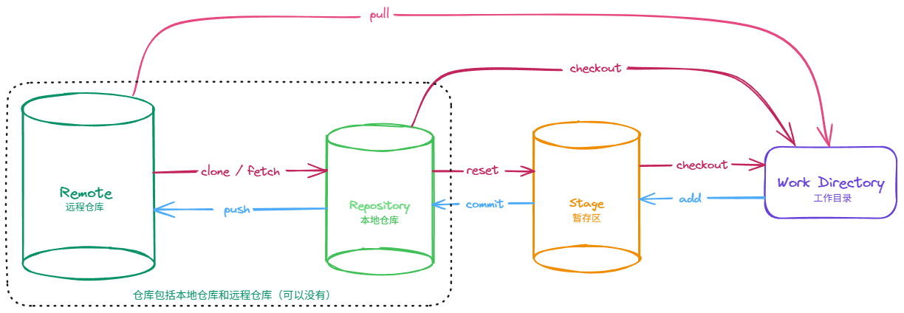
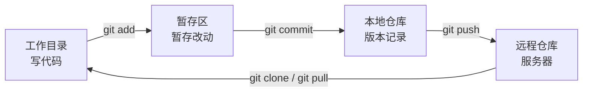

# Git 学习笔记

> 从安装配置、基本命令，到分支、远程仓库与多人协作冲突处理的完整梳理。
> 适用对象：刚开始使用 Git / 需要一份可随手查阅的命令速查表的人。

---

## 目录

- 零、Git 是什么
- 一、安装与配置
- 二、基本命令
- 三、忽略文件（.gitignore）
- 四、版本回退
- 五、分支
- 六、远程仓库
- 七、访问方式：HTTPS 令牌 与 SSH
- 八、远程分支
- 九、抓取、拉取与冲突解决
- 十、常用命令速查表
- 十一、Git LFS（大文件管理，增删改查）

---

## Git 是什么

Git 是一个**分布式版本控制系统**，用来记录代码的每一次改动，并支持多人协作开发。



Git 的工作流程可以概括为 4 个区域：

| 区域 | 作用 |
| :--- | :--- |
| **工作目录**（工作区） | 写代码的地方，文件实际存放的位置 |
| **暂存区**（Stage / Index） | 暂存待提交的改动，是"提交前的预览区" |
| **本地仓库** | 存本机上的版本记录 |
| **远程仓库** | 存服务器上的版本记录，可与本地互推互拉 |

**数据流向：**



> **两条方向规则：**
>
> - **远程仓库 → 本地仓库 → 暂存区 → 工作目录**：文件可以依次"检出"，也可以直接从远程仓库"检出"到工作目录。
> - **工作目录 → 暂存区 → 本地仓库 → 远程仓库**：必须按顺序逐步提交 / 推送。

---

## 一、安装与配置

### 1.1 下载安装

前往 Git 官网下载安装包：<https://git-scm.com/download/win>

安装时一路默认即可，其中"默认编辑器"一项可以按自己的习惯选择（如 VS Code、Notepad++）。

### 1.2 配置用户名和邮箱

安装完成后，需要设定用户名和邮箱，用来区分不同的提交者：

```shell
git config --global user.name "Your Name"
git config --global user.email "email@example.com"
```

### 1.3 验证配置

查看全局配置是否生效：

```shell
git config --global --list
```

执行后，应该能在输出里看到类似这两行：

```
user.name=Your Name
user.email=email@example.com
```

默认分行显示时形如 `user.name=Your Name`；也可以直接查看单项：

```shell
git config --global user.name
git config --global user.email
```

### 1.4 配置的层级

| 参数 | 作用范围 | 配置文件位置 |
| :--- | :--- | :--- |
| `--global` | 当前用户的所有仓库 | 用户目录下的 `.gitconfig` |
| `--local` | 仅当前仓库（默认） | 仓库内的 `.git/config` |
| `--system` | 本机所有用户 | 系统级配置文件 |

> 一般个人电脑只需配置 `--global`；如果某个仓库要换一个提交身份，再在该仓库内单独执行一次不带 `--global` 的命令即可。

---

## 二、基本命令

以下场景以新建文件 `test.txt` 为例。

### 2.1 常用命令一览

| Git 命令 | 解释 |
| :--- | :--- |
| `git init` | 在当前目录创建（初始化）本地仓库 |
| `git add test.txt` | 把 `test.txt` 添加到暂存区 |
| `git add .` | 一次性把当前目录下所有改动添加到暂存区 |
| `git commit -m "新建 test.txt"` | 把暂存区的内容提交到本地仓库；`-m` 后跟**提交信息**，用于描述这次提交做了什么 |

### 2.2 查看状态

```shell
git status
```

会显示当前工作目录和暂存区的状态（哪些文件被修改了、哪些已经 `add` 了、哪些还没被追踪）。

### 2.3 跳过 git add

```shell
git commit -a -m "修改 test.txt"
```

跳过 `git add` 这一步，直接把**已经被 Git 追踪（tracked）的文件**的修改提交到本地仓库。

> ⚠️ `-a` 只对已被追踪的文件生效。**新建的文件仍然需要先 `git add`**，否则不会被提交。

### 2.4 追加到上一次提交（不产生新记录）

忘了加某个文件，或提交信息写错了，想追加到上一次提交而不产生新的记录：

> ⚠️ 只建议在**未推送到远程仓库之前**使用，否则会给协作者带来麻烦。

```shell
# 场景一：只想修改上一次的提交信息
git commit --amend -m "新的提交信息"

# 场景二：忘了加文件，想追加到上一次提交（不产生新的提交记录）
git add 忘记的文件
git commit --amend --no-edit
```

### 2.5 查看提交内容

```shell
git show             # 查看最近一次提交的详细内容
git show a1b2c3d     # 查看指定 commit ID 的提交详情
git diff             # 查看工作目录与暂存区的差异（还没 add 的改动）
git diff --staged    # 查看暂存区与本地仓库的差异（已经 add 的改动）
```

### 2.6 查看提交记录

先用 `git log` 或 `git log --oneline` 查看提交记录，每一行开头那一串字符（比如 `a1b2c3d...`）就是 commit ID。

```shell
git log              # 完整提交记录
git log --oneline    # 每个提交压缩成一行，更简洁
git log --graph      # 以图形方式展示分支合并历史
```

```shell
git log --oneline
# 输出示例：
# a1b2c3d 新建 test.txt
# e4f5g6h 修改 test.txt
```

常用组合：

```shell
# 图形化 + 单行 + 全部分支，查看分支走向最直观
git log --all --graph --oneline

# 查看某个文件的修改历史
git log test.txt
```

### 2.7 撤销暂存（把文件从暂存区取回）

```shell
git restore --staged test.txt   # Git 2.23+ 推荐写法
git reset HEAD test.txt         # 旧版本写法，效果相同
```

作用：文件不再处于暂存状态，但**工作目录里的修改仍然保留**。

---

## 三、忽略文件（.gitignore）

在仓库根目录新建 `.gitignore` 文件，写下不希望被 Git 追踪的文件或目录，它们就不会出现在 `git status` 里，也不会被提交。

```shell
# 匹配所有以 txt 结尾的文件
*.txt

# 虽然上面排除了所有 txt 结尾的文件，但是这个文件不排除
!666.txt

# 也可以直接指定一个文件夹，文件夹下的所有文件将全部忽略
test/

# 只忽略本目录下以 txt 结尾的文件，不包括子目录
xxx/*.txt

# 忽略 xxx 目录（含子目录）中所有以 txt 结尾的文件
xxx/**/*.txt
```

**常用规则说明：**

| 写法 | 含义 |
| :--- | :--- |
| `*.log` | 忽略所有 `.log` 文件 |
| `!important.log` | `!` 表示"不忽略"，用于给前面的规则开例外 |
| `build/` | 忽略 `build` 目录下的全部内容 |
| `/config` | 以 `/` 开头表示只匹配仓库根目录下的 `config` |
| `**/temp` | `**` 匹配任意层级的目录 |

**检查忽略是否生效：**

```shell
git check-ignore -v 文件名   # 查看是哪条规则忽略了这个文件
```

> ⚠️ 已经被追踪（tracked）的文件，加入 `.gitignore` 后**不会自动失效**，需要先从暂存区移除：
>
> ```shell
> git rm --cached 文件名      # 只从 Git 中移除，本地文件保留
> ```

---

## 四、版本回退

### 4.1 三种回退模式

```shell
git reset --soft  commitID   # 回退版本，保留暂存区和工作目录
git reset --mixed commitID   # 回退版本，保留工作目录（默认模式）
git reset --hard  commitID   # 回退版本，同时丢弃所有未提交修改（⚠️ 慎用）
```

### 4.2 三种模式对比

| 命令 | 本地仓库 | 暂存区 | 工作目录 | 适用场景 |
| :--- | :--- | :--- | :--- | :--- |
| `git reset --soft ID` | 回退 | 保留 | 不动 | 想重新提交 |
| `git reset --mixed ID` | 回退 | 清空 | 不动 | 想重新 add |
| `git reset --hard ID` | 回退 | 清空 | 清空 | 彻底放弃当前修改（慎用） |

> 记忆口诀：**soft 只动仓库，mixed 再动暂存区，hard 连工作目录一起清空**。

### 4.3 回退后想反悔？

`git reset` 之后，被"丢掉"的提交仍然留在 Git 的操作记录里，可以找回来：

```shell
git reflog                   # 查看 HEAD 移动历史（包括回退、切换等），找到回滚前的 ID
git reset --hard <原来的ID>   # 回到回滚前的状态
```

> 💡 `git reflog` 是回退操作的"后悔药"，即使 `--hard` 丢掉了提交，也能通过它找回。

### 4.4 撤销某次提交的改动（推荐用于已推送的提交）

```shell
git revert commitID   # 生成一次新的"反向提交"，用来抵消指定提交的改动
```

`revert` 不会改写历史，因此**已经推送到远程的提交，用 `revert` 更安全**（`reset` 改写历史，不适合已共享的分支）。

---

## 五、分支

分支可以理解为**指向某次提交的可移动指针**。有了分支，就可以在不影响主线的情况下开发新功能。

### 5.1 分支基本命令

**查看所有分支**

```shell
git branch        # 查看本地分支
git branch -r     # 查看远程分支
git branch -a     # 查看本地分支 + 远程分支
git branch -vv    # 查看本地分支及其绑定的远程分支
```

其中当前所在分支前面会带一个 `*`。

**查看当前仓库状态**

```shell
git status
```

**新建分支**

```shell
git branch test   # 新建分支 test，但仍停留在当前分支
```

**切换分支**

```shell
git checkout test   # 切换至分支 test
git checkout main   # 切换至分支 main

# 新版命令（Git 2.23+，语义更清晰，推荐）
git switch test       # 切换分支
git switch -c test    # 创建并切换（等价于 git checkout -b test）
```

**创建并切换**

```shell
git checkout -b test
```

**删除分支**

```shell
git branch -d test   # 安全删除，若分支未合并会报错
git branch -D test   # 强制删除未合并的分支
```

**查看所有分支的提交记录**

```shell
git log --all --graph --oneline
```

### 5.2 合并分支

先切换回主分支：

```shell
git checkout main
```

接着使用分支合并命令：

```shell
git merge test
```

如果产生冲突，会提示：

```
Auto-merging test.txt
CONFLICT (content): Merge conflict in test.txt
Automatic merge failed; fix conflicts and then commit the result.
```

#### 解决冲突的步骤

1. **查看冲突位置**

   ```shell
   git diff     # 查看具体哪里冲突
   ```

   也可以直接打开 `test.txt`，会看到类似这样的标记：

   ```
   <<<<<<< HEAD
   你当前分支的内容
   =======
   要合并进来的分支的内容
   >>>>>>> test
   ```

   标记含义：

   - `<<<<<<< HEAD` 到 `=======` 之间：**当前分支**的内容
   - `=======` 到 `>>>>>>> test` 之间：**要合并进来**的分支内容

2. **手动编辑文件**，只保留想要的内容，删掉所有标记（`<<<<<<<`、`=======`、`>>>>>>>`）。

3. **标记已解决并提交**

   ```shell
   git add test.txt
   git commit -m "解决合并冲突"
   ```

> 💡 如果中途想放弃这次合并，回到合并前的状态：
>
> ```shell
> git merge --abort
> ```

### 5.3 完整实例

**第 1 步：创建 `test` 分支**

```shell
git branch test
```

```
main:     A --- B --- C
                       \
test:                   (新建，指向 C)
```

**第 2 步：切换分支至 `test` 并开发**

```shell
git switch test
```

```
main:     A --- B --- C
                       \
test:                   D
```

**第 3 步：合并 `test` 至 `main` 分支**

```shell
git checkout main
git merge test
```

```
main:     A --- B --- C ------- E   （E 是合并提交）
                       \       /
test:                   D
```

**第 4 步：删除 `test` 分支**

```shell
git branch -d test
```

```
main:     A --- B --- C ------- E
```

### 5.4 变基分支（rebase）

`rebase`（变基）的作用是：**修改分支的起点**，把一个分支的提交"搬"到另一个分支的最新提交之后。

比如我们希望把 `test` 分支变基到 `main` 上：

1. **先切换到要变基的分支**（这里是 `test`）：

   ```shell
   git checkout test
   ```

2. **执行变基**：

   ```shell
   git rebase main
   ```

   > 效果：`test` 分支会从它原来的起点，移动到 `main` 分支最新一次提交的位置后面。

变基后，`test` 相当于同步了此前 `main` 分支的全部提交，历史记录会变得更"直"。

> ⚠️ **注意**：`rebase` 会**改写提交历史**（产生新的 commit ID）。
> 因此**只建议在自己的本地分支上使用**，**不要对已经推送到远程仓库、且被别人使用的分支做 rebase**。

#### 实例

现在 `main` 和 `test` 的状态如下：

```
main:     A --- B --- C --- F
                 \
test:             D --- E
```

切换到 `test` 分支：

```shell
git switch test
```

```
main:     A --- B --- C --- F
                 \
test:             D --- E
                              ↑
                           HEAD 在这里
```

执行变基：

```shell
git rebase main
```

```
main:     A --- B --- C --- F
                             \
test:                         D' --- E'
                                      ↑
                                   HEAD 在这里
```

说明：

- `test` 分支的 `D`、`E` 被"搬"到了 `F` 后面
- `D'`、`E'` 是**新的 commit ID**（内容一样，但历史被改写了）
- 历史变成一条直线，看起来更干净

**rebase 与 merge 的区别：**

| 对比项 | `git merge` | `git rebase` |
| :--- | :--- | :--- |
| 历史形态 | 保留分叉，多一个合并提交 | 变成一条直线 |
| commit ID | 不变 | 被改写（产生新 ID） |
| 是否安全 | 安全，可用于公共分支 | 只用于本地分支 |

变基过程中如果遇到冲突，解决后继续：

```shell
git add 冲突文件
git rebase --continue

# 想放弃变基，回到变基前的状态
git rebase --abort
```

### 5.5 优选分支（cherry-pick）

`cherry-pick` 的作用是：**把其他分支上的某一次提交，单独"复制"到当前分支上**。

命令格式：

```shell
git cherry-pick <commit id>
```

**使用场景举例：**

1. 先切换到 `test` 分支：

   ```shell
   git checkout test
   ```

2. 在 `main` 分支上创建了一个新文件并提交，拿到了这次提交的 ID。

3. 在 `test` 分支上执行：

   ```shell
   git cherry-pick <那次提交的 commit id>
   ```

   这样，`main` 上的那一次提交就被单独应用到了 `test` 分支上，而不会把 `main` 的其他提交也带过来。

#### 实例

现在 `main` 和 `test` 的状态如下：

```
main:     A --- B --- C --- F
                 \
test:             D --- E
```

假设我们只想要 `main` 上的 `F` 这一次提交，把它"复制"到 `test` 上。

先切换到 `test` 分支：

```shell
git switch test
```

```
main:     A --- B --- C --- F
                 \
test:             D --- E
                              ↑
                           HEAD 在这里
```

执行优选：

```shell
git cherry-pick F
```

```
main:     A --- B --- C --- F
                 \
test:             D --- E --- F'
                              ↑
                         内容同 F，ID 不同
```

说明：

- 只把 `main` 上的 `F` 这一次提交，单独"复制"到了 `test` 分支
- `F'` 是**新的 commit ID**，内容和 `F` 一样
- `main` 上的其他提交（A、B、C）**不会**被带过来

> 💡 一次优选多个提交，按从左到右的顺序应用：
>
> ```shell
> git cherry-pick <ID1> <ID2>
> ```

---

## 六、远程仓库

远程仓库（如 GitHub、Gitee、GitLab）用来托管代码，也是多人协作的中心。

### 6.1 在 GitHub 上创建仓库

GitHub 官网：<https://github.com/>

1. 登录 GitHub，点击右上角 **+** → **New repository**
2. 填写仓库信息：
   - **Repository name**：仓库名，比如 `my-project`
   - **Description**：描述（可选）
   - **Public / Private**：公开或私有
   - **Initialize this repository with**：
     - 如果本地已有项目，**不要勾选** README、.gitignore、license
     - 如果从零开始，可以勾选 README
3. 点击 **Create repository**
4. 创建后会看到一个空仓库页面，里面会提示你如何关联本地仓库：

```shell
git remote add origin git@github.com:用户名/仓库名.git
git branch -M main
git push -u origin main
```

> 💡 `git branch -M main` 的作用是把当前分支重命名为 `main`（兼容 GitHub 的默认分支名）。

### 6.2 绑定本地仓库与远程仓库

```shell
git remote add origin 远程仓库地址   # 添加远程仓库，并命名为 origin
git remote -v                        # 查看已绑定的远程仓库地址
```

如果要更换远程地址：

```shell
git remote set-url origin 新的远程地址
```

> 说明：`origin` 只是**远程仓库的默认别名**，可以自定义；大多数情况下保持默认即可。

### 6.3 修改远程仓库

**a. 修改仓库名**

- 进入仓库 → **Settings** → **General**
- 在 **Repository name** 处修改，点击 **Rename**

**b. 修改仓库描述**

- 进入仓库 → 右侧 **About** 旁的齿轮图标
- 修改 **Description**，点击 **Save changes**

**c. 修改仓库可见性**

- 进入仓库 → **Settings** → **General**
- 拉到最下面 **Danger Zone** → **Change repository visibility**
- 选择 **Public** 或 **Private**，按提示确认

**d. 删除仓库**

- 进入仓库 → **Settings** → **General**
- 拉到最下面 **Danger Zone** → **Delete this repository**
- 输入仓库名确认删除

> ⚠️ **注意**：删除仓库不可恢复，里面的代码、Issue、PR 都会一起消失。

### 6.4 推送项目

```shell
git remote add 名称 远程仓库地址
git push 远程仓库名称 本地分支名称[:远端分支名称]
```

实际使用中最常见的形式：

```shell
git push -u origin main   # -u 表示把本地 main 与 origin/main 绑定，之后直接 git push 即可
git push origin dev       # 把本地 dev 推送到远程同名分支
git push origin main:test # 把本地 main 推送到远程的 test 分支
```

> 如果推送被拒绝（`! [rejected] ... (fetch first)`），说明远程有别人更新的提交，**先 `git pull` 再推送**，详见第九章。

### 6.5 添加合作者

**a. 添加合作者**

登录自己的账号后，点击右上角头像 → **Settings** 即可进入个人设置页面：

- 进入仓库 → **Settings** → **Collaborators**
- 点击 **Add people**
- 输入对方的 GitHub 用户名或邮箱
- 选择权限（Read / Write / Admin）
- 点击 **Add**

对方会收到邀请邮件，接受后就能推送代码到该仓库。

**b. 权限说明**

| 权限 | 说明 |
| :--- | :--- |
| Read | 只能查看、克隆，不能推送 |
| Write | 可以推送、创建分支、合并 PR |
| Admin | 可以修改仓库设置、删除仓库 |

**c. 移除合作者**

- 进入仓库 → **Settings** → **Collaborators**
- 找到对应用户，点击 **Remove**

**d. 合作者与组织的区别**

- **合作者（Collaborator）**：针对单个仓库，适合小团队
- **组织（Organization）**：可以管理多个仓库和成员，适合公司或较大团队

---

## 七、访问方式：HTTPS 令牌 与 SSH

推送 / 拉取代码前，必须先通过 GitHub 的身份验证。有两种方式：

| 方式 | 地址形式 | 是否需要输密码 | 适合场景 |
| :--- | :--- | :--- | :--- |
| **HTTPS + 令牌** | `https://github.com/...` | 需要（输令牌） | 临时使用、公司网络限制 SSH 时 |
| **SSH** | `git@github.com:...` | 不需要，配置一次长期免密 | 长期开发（**推荐**） |

### 7.1 方式一：Personal Access Token（令牌）

GitHub 从 2021 年 8 月起，**不再支持用账号密码直接推送**，必须用 **Personal Access Token（个人访问令牌）** 代替密码。

```
生成令牌 → git remote add → git push → 输入用户名 + 令牌 → 完成
```

#### a. 生成令牌

1. 登录 GitHub，点击右上角头像 → `Settings`
2. 左侧菜单拉到最下面 → `Developer settings`
3. 选择 `Personal access tokens` → `Tokens (classic)`
4. 点击 `Generate new token` → `Generate new token (classic)`
5. 填写：
   - **Note**：备注，比如 `my-laptop`
   - **Expiration**：有效期，建议选 90 天或自定义
   - **Scopes**：勾选权限
     - 至少勾选 **`repo`**（完整仓库读写权限）
     - 如果需要操作 GitHub Actions，再勾选 **`workflow`**
6. 点击 **Generate token**
7. **立即复制令牌**（形如 `ghp_xxxxxxxxxxxx`），刷新页面后就看不到了

> ⚠️ **注意**：令牌只显示一次，务必先复制保存。

#### b. 使用令牌推送

```shell
git remote add origin https://github.com/用户名/仓库名.git
git push -u origin main
```

执行后会提示输入用户名和密码：

```
Username: 你的GitHub用户名
Password: 粘贴刚才生成的令牌
```

> 注意：粘贴令牌时终端**不会显示任何字符**，这是正常的，粘贴完直接回车即可。

推送成功后，之后再用 `git push` 就不需要重复输入了（凭证会被系统缓存）。

#### c. 常见问题

**1. 推送时报 `Authentication failed`**

- 检查令牌是否过期
- 检查是否勾选了 `repo` 权限
- 检查远程地址是不是 `https`（`ssh` 地址不能用令牌）

**2. 推送时报 `remote: Support for password authentication was removed`**

说明你输的是账号密码，不是令牌。重新生成令牌，按上面方式输入。

**3. 令牌泄露了怎么办？**

立刻去 GitHub → Settings → Developer settings → Tokens，找到对应令牌，点击 **Delete** 删除，然后重新生成一个。

**4. 不想每次输令牌？**

改用 SSH（更安全，推荐长期使用）。

### 7.2 方式二：SSH（推荐）

```
生成密钥 → 复制公钥 → 添加到 GitHub → 测试连接 → 换 SSH 地址 → 推送
```

SSH 方式的优势：

- **免密**：配置一次，以后 `git push` 再也不需要输入用户名和令牌
- **更安全**：SSH 使用非对称加密，私钥只存在你本地，不会在网络上传输
- **更省心**：不会像令牌那样过期，也不用担心泄露

#### a. 生成 SSH 密钥

打开终端（Windows 用 Git Bash），执行：

```shell
ssh-keygen -t rsa -b 4096 -C "你的邮箱@example.com"
```

说明：

- `-t rsa`：指定密钥类型为 RSA
- `-b 4096`：密钥长度 4096 位（更安全）
- `-C`：注释，一般填邮箱，方便识别

执行后会提示：

```
Enter file in which to save the key (/c/Users/你/.ssh/id_rsa):
```

> 直接**回车**，使用默认路径。

接着提示：

```
Enter passphrase (empty for no passphrase):
```

> 建议：**直接回车，不设密码**（个人电脑）。

- 如果直接回车：生成**无密码**密钥，以后完全免密
- 如果输入密码：每次使用 SSH 都要输这个密码（更安全，但麻烦）

#### b. 查看并复制公钥

```shell
cat ~/.ssh/id_rsa.pub
```

输出形如：

```
ssh-rsa AAAAB3NzaC1yc2EAAAADAQABAAACAQ... 你的邮箱@example.com
```

**完整复制这一整行**（从 `ssh-rsa` 到邮箱结尾）。

> Windows 用户也可以直接用记事本打开 `C:\Users\你的用户名\.ssh\id_rsa.pub`。

#### c. 把公钥添加到 GitHub

1. 登录 GitHub，点击右上角头像 → **Settings**
2. 左侧菜单 → **SSH and GPG keys**
3. 点击 **New SSH key**
4. 填写：
   - **Title**：备注，比如 `my-laptop`
   - **Key type**：选 **Authentication Key**
   - **Key**：粘贴刚才复制的公钥内容
5. 点击 **Add SSH key**

#### d. 测试 SSH 连接

```shell
ssh -T git@github.com
```

首次连接会提示：

```
The authenticity of host 'github.com (xxx.xxx.xxx.xxx)' can't be established.
Are you sure you want to continue connecting (yes/no)?
```

输入 `yes` 回车。

如果配置成功，会看到：

```
Hi 你的用户名! You've successfully authenticated, but GitHub does not provide shell access.
```

看到这句话就说明 SSH 配置成功了。

#### e. 使用 SSH 推送

**1. 新仓库：添加 SSH 远程地址**

```shell
git remote add origin git@github.com:用户名/仓库名.git
git push -u origin main
```

**2. 已有仓库：把 HTTPS 地址换成 SSH**

先查看当前远程地址：

```shell
git remote -v
```

如果显示的是 `https://github.com/...`，改成 SSH：

```shell
git remote set-url origin git@github.com:用户名/仓库名.git
```

再推送：

```shell
git push
```

#### f. 常见问题

**1. `ssh -T git@github.com` 报 `Permission denied (publickey)`**

- 检查公钥是否已正确添加到 GitHub
- 检查 `~/.ssh/id_rsa` 和 `id_rsa.pub` 是否存在
- 检查远程地址是否是 SSH 格式（`git@github.com:...`）

**2. 推送时报 `Host key verification failed`**

执行：

```shell
ssh-keyscan github.com >> ~/.ssh/known_hosts
```

**3. 有多台电脑，想用同一个 GitHub 账号**

每台电脑都生成一对密钥，把各自的公钥都添加到 GitHub 即可。

**4. 想给不同 GitHub 账号配不同密钥**

需要配置 `~/.ssh/config`：

```
Host github-work
    HostName github.com
    User git
    IdentityFile ~/.ssh/id_rsa_work

Host github-personal
    HostName github.com
    User git
    IdentityFile ~/.ssh/id_rsa_personal
```

然后远程地址写成：

```shell
git@github-work:公司账号/仓库名.git
```

---

## 八、远程分支

### 8.1 查看远程分支

```shell
git branch -a    # 查看所有分支（本地 + 远程）
git branch -r    # 只看远程分支
git remote -v    # 查看远程仓库列表
git branch -vv   # 查看本地分支与远程分支的绑定关系
```

`git branch -a` 输出示例：

```
* main
  dev
  remotes/origin/main
  remotes/origin/dev
  remotes/origin/feature-login
```

说明：

- `* main`：当前所在的本地分支
- `dev`：本地分支
- `remotes/origin/xxx`：远程分支在本地的记录（远程跟踪分支）

`git branch -vv` 输出示例：

```
* main a1b2c3d [origin/main] 首次提交
  dev  e4f5g6h [origin/dev] 开发分支
```

`[origin/main]` 表示本地 `main` 已绑定远程 `origin/main`。

### 8.2 拉取远程分支到本地

**a. 抓取远程最新信息（不合并）**

```shell
git fetch origin
```

作用：把远程所有分支的最新提交抓取到本地，但**不自动合并**。抓取后，`remotes/origin/xxx` 会更新到最新。

**b. 切换到远程已有分支**

如果远程有一个 `dev` 分支，本地没有：

```shell
git checkout dev
```

Git 会自动：

- 创建本地 `dev` 分支
- 关联到 `origin/dev`
- 切换到 `dev`

也可以显式写：

```shell
git checkout -b dev origin/dev
```

**c. 创建本地分支并关联远程分支**

```shell
git switch -c dev origin/dev
```

或者先建分支再绑定：

```shell
git switch -c dev
git branch --set-upstream-to=origin/dev dev
```

**d. 拉取远程分支最新代码**

```shell
git pull origin dev
```

如果当前就在 `dev` 分支，并且已经绑定：

```shell
git pull
```

### 8.3 推送新分支到远程

**a. 本地新建分支**

```shell
git switch -c dev
```

**b. 开发并提交**

```shell
git add .
git commit -m "开发新功能"
```

**c. 推送到远程，生成远程分支**

```shell
git push -u origin dev
```

执行后：

- 远程仓库新增 `dev` 分支
- 本地 `dev` 与 `origin/dev` 绑定

输出示例：

```
 * [new branch]      dev -> dev
branch 'dev' set up to track 'origin/dev'.
```

**d. 以后直接推送**

```shell
git push
```

### 8.4 删除远程分支

**a. 删除远程分支**

```shell
git push origin --delete 分支名
```

例如：

```shell
git push origin --delete dev
```

> 注意：删除远程分支**不会**删除本地分支。本地分支要用 `git branch -d dev` 单独删。

**b. 清理本地失效的远程分支记录**

远程分支被删了，但本地 `git branch -r` 还能看到，可以清理：

```shell
git remote prune origin
```

或者：

```shell
git fetch -p
```

`-p` 是 `--prune` 的简写，表示"修剪"，会清理本地已失效的远程分支记录。

---

## 九、抓取、拉取与冲突解决

多人协作时最常遇到的问题就是**推送被拒绝**和**合并冲突**。本章用程序员 A 和 B 共用一个远程仓库的场景，把整个流程串一遍。

### 9.1 A 和 B 各改各的，互不冲突

假设团队里有两位程序员 **A** 和 **B**，共用同一个远程仓库，各自负责不同模块。

```
远程仓库 (origin)
      │
      ├── 程序员 A 的本地仓库
      └── 程序员 B 的本地仓库
```

**时间线：**

```
1. A 完成模块，提交并推送
   A: git add . && git commit -m "完成A模块" && git push

2. B 开始写代码前，先拉取远程最新
   B: git pull origin main

3. B 在最新代码基础上开发，提交并推送
   B: git add . && git commit -m "完成B模块" && git push
```

**示意图：**

```
远程仓库:   A --- B
              ↑
              │
A 本地:      A
B 本地:      拉取后同步 → B
```

- A 推送后，远程更新到 `A`
- B 拉取后，本地也同步到 `A`
- B 在 `A` 基础上继续提交 `B`，再推送，一切正常

### 9.2 B 拉取前，想先看看远程有什么更新

**事件：B 想先看远程有没有新提交，再决定要不要合并。**

```shell
git fetch origin
```

**抓取与拉取的区别：**

| 命令 | 作用 | 是否自动合并 |
| :--- | :--- | :--- |
| `git fetch` | 只把远程更新抓取到本地 | ❌ 不合并 |
| `git pull` | 抓取 + 合并到当前分支 | ✅ 自动合并 |

> ```
> git pull = git fetch + git merge
> ```

**示意图：**

```
远程仓库:   A --- B
              │
              │  git fetch（只抓取，不合并）
              ↓
B 本地:      A      ← 远程分支记录更新了，但当前分支没变
```

### 9.3 A 和 B 修改了同一个文件，B 推送被拒绝

**事件：A 修改了 `hello.txt` 并推送，B 也修改了 `hello.txt` 并推送。**

```
1. A 修改 hello.txt 并推送
   A: git add hello.txt && git commit -m "A修改" && git push

2. B 也修改 hello.txt 并推送
   B: git add hello.txt && git commit -m "B修改" && git push
```

**B 推送时会被拒绝：**

```
To https://github.com/xx/xxx.git
 ! [rejected]        main -> main (fetch first)
error: failed to push some refs to 'https://github.com/xx/xxx.git'
hint: Updates were rejected because the remote contains work that you do
hint: not have locally. This is usually caused by another repository pushing
hint: to the same ref. You may want to first integrate the remote changes
hint: (e.g., 'git pull ...') before pushing again.
hint: See the 'Note about fast-forwards' in 'git push --help' for details.
```

**原因**：远程仓库已经有 A 的提交，B 的本地仓库还是旧的，直接推送会覆盖 A 的改动，Git 不允许。

**示意图：**

```
远程仓库:   A --- B(A的提交)
              ↑
              │
A 本地:      A
B 本地:      A --- B(B的提交，基于旧版本)

B 推送 → 被拒绝（远程已有 A 的新提交）
```

### 9.4 B 拉取后发现改的不是同一个文件，自动合并成功

**事件：B 执行 `git pull`，发现自己和 A 改的不是同一个文件。**

```shell
git pull origin main
```

Git 自动合并，无需手动处理。

```
远程仓库:   A --- B
B 本地:     A --- B（自动合并成功）
```

合并完成后，再推送即可：

```shell
git push origin main
```

### 9.5 B 拉取后发现改的是同一个文件，手动解决冲突

**事件：B 执行 `git pull`，发现和 A 改的是同一个文件，产生冲突。**

```shell
git pull origin main
```

Git 提示冲突：

```
Auto-merging hello.txt
CONFLICT (content): Merge conflict in hello.txt
Automatic merge failed; fix conflicts and then commit the result.
```

打开 `hello.txt`，会看到冲突标记：

```
<<<<<<< HEAD
B 修改的内容
=======
A 修改的内容
>>>>>>> origin/main
```

**解决步骤：**

1. 编辑文件，只保留想要的内容，删掉 `<<<<<<<`、`=======`、`>>>>>>>` 标记
2. 标记已解决：

   ```shell
   git add hello.txt
   git commit -m "解决合并冲突"
   ```

3. 再次推送：

   ```shell
   git push origin main
   ```

### 9.6 完整协作流程

```
A 推送成功
    │
    ↓
远程仓库更新
    │
    ↓
B 推送被拒绝
    │
    ↓
B 执行 git pull
    │
    ├── 不同文件 → 自动合并 → 推送成功
    │
    └── 同一文件 → 冲突 → 手动解决 → add + commit → 推送成功
```

### 9.7 本章小结

```
多人协作核心流程：
1. 开发前先 git pull，同步远程最新
2. 开发完成后 git add + git commit
3. git push 推送
4. 如果被拒绝，先 git pull，解决冲突后再 push
```

> 一句话总结：**推之前先拉，冲突手动解，解完再推。**

---

## 十、常用命令速查表

### 10.1 仓库与配置

| 命令 | 作用 |
| :--- | :--- |
| `git init` | 初始化本地仓库 |
| `git clone 地址` | 克隆远程仓库到本地 |
| `git config --global --list` | 查看全局配置 |
| `git remote -v` | 查看远程仓库地址 |
| `git remote add origin 地址` | 绑定远程仓库 |
| `git remote set-url origin 地址` | 修改远程地址 |

### 10.2 提交相关

| 命令 | 作用 |
| :--- | :--- |
| `git status` | 查看工作区状态 |
| `git add .` | 把所有改动加入暂存区 |
| `git commit -m "说明"` | 提交到本地仓库 |
| `git commit -a -m "说明"` | 跳过 add，提交已追踪文件的修改 |
| `git commit --amend` | 追加到上一次提交 |
| `git diff` / `git diff --staged` | 查看未暂存 / 已暂存的差异 |
| `git log --oneline --graph --all` | 查看提交历史 |

### 10.3 撤销与回退

| 命令 | 作用 |
| :--- | :--- |
| `git restore --staged 文件` | 把文件移出暂存区（保留修改） |
| `git reset --soft ID` | 回退提交，保留暂存区和工作区 |
| `git reset --hard ID` | 回退提交，丢弃所有改动（慎用） |
| `git revert ID` | 生成反向提交，撤销某次提交 |
| `git reflog` | 查看操作历史，用于找回提交 |

### 10.4 分支相关

| 命令 | 作用 |
| :--- | :--- |
| `git branch` / `git branch -a` | 查看本地 / 全部分支 |
| `git switch -c dev` | 创建并切换到 `dev` |
| `git switch dev` | 切换分支 |
| `git merge dev` | 把 `dev` 合并到当前分支 |
| `git rebase main` | 把当前分支变基到 `main` |
| `git cherry-pick ID` | 把某次提交复制到当前分支 |
| `git branch -d dev` / `-D` | 删除分支（安全 / 强制） |

### 10.5 远程同步

| 命令 | 作用 |
| :--- | :--- |
| `git fetch origin` | 抓取远程更新，不合并 |
| `git pull` | 抓取并合并远程更新 |
| `git push` | 推送当前分支到远程 |
| `git push -u origin dev` | 推送新分支并绑定 |
| `git push origin --delete dev` | 删除远程分支 |
| `git fetch -p` | 清理本地失效的远程分支记录 |

### 10.6 Git LFS 常用命令

| 命令 | 作用 |
| :--- | :--- |
| `git lfs install` | 启用 LFS（全局） |
| `git lfs track "*.psd"` | 添加 LFS 追踪规则（写入 `.gitattributes`） |
| `git lfs track` | 查看当前追踪规则 |
| `git lfs untrack "*.psd"` | 取消追踪规则 |
| `git lfs ls-files` | 查看文件中被 LFS 追踪的清单（`-s` 看标记，`--all` 看历史） |
| `git lfs status` | 查看 LFS 相关的待提交改动 |
| `git lfs pull` | 补下载 LFS 文件内容 |
| `git lfs prune` | 清理本地 LFS 缓存 |
| `git lfs migrate import --include="*.psd"` | 把历史中的大文件改写成 LFS |

> 详细的增删改查见第十一章。

---

## 十一、Git LFS（大文件管理，增删改查）

> 本章按 **增（添加追踪规则）→ 查（查看状态）→ 改（修改规则与历史）→ 删（删除与清理）** 的顺序整理，只想要命令的直接看 10.6 速查表。

### 11.1 为什么需要 LFS

Git 会把**每个版本的文件完整存进仓库**。一个 200 MB 的视频改 10 次，仓库里就会多出 2 GB 的历史，`git clone` 会越来越慢，GitHub 还限制单文件不能超过 100 MB。

**Git LFS（Large File Storage）** 的做法是：仓库里只存一个**很小的文本指针**，真正的文件内容放在 LFS 存储区，按需下载。

```
普通 Git： 仓库里存 → 200MB 视频的每一个版本
Git LFS：  仓库里存 → version https://git-lfs.github.com/spec/v1
                    oid sha256:4d7a214614ab2935c943f9e0ff69d22e...
                    size 209715200
           实际文件   → 存放在 LFS 存储区，克隆时按需拉取
```

适合放进 LFS 的：视频、音频、设计稿（PSD/AI）、数据集、模型权重、压缩包、字体、大图。
**不适合**的：代码、配置、文档 —— 这些是纯文本，Git 的差异压缩本来就很高效。

> ⚠️ 两个前提：**GitHub 的 LFS 存储和流量有免费额度**（超出需付费）；**协作者也必须安装 Git LFS**，否则他克隆下来只会得到一个几十字节的指针文件。

### 11.2 安装与初始化

**第 1 步：安装 Git LFS 命令行工具**

- **Windows**：去 <https://git-lfs.com> 下载安装包，或执行 `winget install GitHub.GitLFS`
- **macOS**：`brew install git-lfs`
- **Ubuntu / Debian**：`sudo apt install git-lfs`

安装后先确认版本：

```shell
git lfs version
```

**第 2 步：在仓库中启用 LFS**

```shell
git lfs install          # 全局启用（推荐，装一次以后所有仓库都能用）
git lfs install --local  # 只对当前仓库启用
```

> 💡 这一步实际是在 Git 里注册 `pre-push` 等钩子。**克隆一个用了 LFS 的仓库后，如果提示找不到 LFS，在仓库里再执行一次 `git lfs install --local` 即可。**

### 11.3 增：添加追踪规则

LFS 的核心是**追踪规则**：告诉 Git「哪些文件要走 LFS」。

```shell
# 按后缀追踪（最常用）
git lfs track "*.psd"
git lfs track "*.mp4"
git lfs track "*.zip"

# 追踪某个具体文件
git lfs track "data/model.bin"

# 追踪某个目录下的所有文件
git lfs track "assets/**"

# 一次追踪多种类型
git lfs track "*.png" "*.jpg" "*.webp"
```

每条 `track` 命令都会往仓库根目录的 **`.gitattributes`** 文件里写一行规则，内容形如：

```
*.psd filter=lfs diff=lfs merge=lfs -text
*.mp4 filter=lfs diff=lfs merge=lfs -text
```

**关键：`.gitattributes` 必须提交，否则别人拿不到规则。**

```shell
git add .gitattributes
git commit -m "配置 Git LFS 追踪规则"
```

正确顺序是：**先 `git lfs track` → 再 `git add 大文件` → 再提交**。如果先把大文件 `add` 进普通 Git，LFS 就管不到它了。

> ⚠️ 常见坑：`.gitignore` 忽略了大文件时，LFS 也是无效的 —— 文件根本没进 Git，自然不会走 LFS。

### 11.4 改：修改追踪规则

```shell
# 追加新的后缀（等价于再执行一次 git lfs track）
git lfs track "*.iso"
git add .gitattributes
git commit -m "新增 iso 走 LFS"

# 取消某个后缀的追踪
git lfs untrack "*.zip"
git add .gitattributes
git commit -m "zip 不再走 LFS"
```

直接编辑 `.gitattributes`、删掉对应的那一行，效果与 `git lfs untrack` 相同。

> ⚠️ **改规则不会改变已经提交过的文件**。`untrack` 之后新提交的 `*.zip` 才会存进普通 Git；历史上已经存进 LFS 的那些文件依然在 LFS 里（要彻底搬走见 11.8）。

### 11.5 查：查看状态与内容

```shell
git lfs ls-files            # 列出当前版本中被 LFS 追踪的所有文件
git lfs ls-files -s         # 附带每行开头的 * / - 标记和文件大小
git lfs ls-files -n         # 只显示文件名，不显示 oid
git lfs ls-files --all      # 列出所有历史版本中出现过的 LFS 文件
git lfs ls-files -I "*.mp4" # 只看匹配某规则的文件

git lfs track               # 查看当前生效的追踪规则（读 .gitattributes）
git lfs status              # 查看 LFS 相关的待提交改动
git lfs env                 # 查看 LFS 的端点、版本等运行环境
git lfs env | grep -i endpoint  # 只关心 LFS 服务器地址
```

`git lfs status` 输出示例：

```
Git LFS objects to be committed:

        design.psd (Git: 3c1b0a2 -> LFS: 4d7a214)

Git LFS objects not staged for commit:

        video.mp4 (LFS: 8e2f9c1)
```

判断一个文件到底走没走 LFS，最简单的办法是看仓库里存的内容：

```shell
git show HEAD:design.psd     # 输出 version https://git-lfs.github.com/spec/v1 就说明走了 LFS
```

### 11.6 改：修改历史中已提交的大文件（迁移）

如果大文件**已经用普通 Git 提交过好几个版本**，可以用 `git lfs migrate` 把历史整体改写成 LFS 指针。

```shell
# 把指定后缀的全部历史改写到 LFS
git lfs migrate import --include="*.psd,*.mp4"

# 指定分支范围
git lfs migrate import --include="*.zip" --include-ref=refs/heads/main

# 变基到远程，保证与远程历史一致
git lfs migrate import --include="*.psd" --everything
```

> ⚠️ **`migrate` 会重写历史（commit ID 全部改变）**，等同于一次全局 rebase。
> 团队仓库必须提前通知所有人，执行后需要用 `git push --force-with-lease` 推送，其他人要重新克隆或重置本地分支。

推送时如果看到 `LFS upload missing objects`，先补传：

```shell
git lfs push --all origin main
```

### 11.7 删：删除文件与清理

**a. 只从 Git 移除，本地文件保留**（和普通文件一个思路）

```shell
git rm --cached 大文件.mp4
git commit -m "不再追踪该文件"
```

**b. 本地彻底删除**

```shell
git rm 大文件.mp4          # 删除文件并记录这次删除
git commit -m "删除大文件"
git push
```

> 注意：**Git 的删除只对新提交生效**，历史版本里的大文件依然存在，仓库体积不会变小。

**c. 拉取时跳过 LFS 文件**（网慢、只想看代码时）

```shell
GIT_LFS_SKIP_SMUDGE=1 git clone 远程地址   # macOS / Linux / Git Bash

# Windows PowerShell 写法
$env:GIT_LFS_SKIP_SMUDGE=1; git clone 远程地址
```

**d. 从 LFS 服务器删除对象**（历史上不再需要，且要回收额度）

```shell
git lfs migrate export --include="*.mp4" --everything   # 把该类型改回普通 Git 存储
git lfs push --all origin main                          # 推送后 LFS 上的旧对象才会被清掉
```

> GitHub 侧的 LFS 存储配额不会因为本地删除而下降，通常需要在仓库的 **Settings → Git LFS** 里查看用量；真的要彻底回收，最干脆的办法是**重建仓库并重新推送**。

### 11.8 日常使用：和普通 Git 几乎一样

配好规则之后，日常操作**完全不需要额外命令**，LFS 会自动接管：

```shell
git add design.psd          # 自动识别为 LFS 文件
git commit -m "更新设计稿"
git push                    # 自动把大文件传到 LFS 存储区
git pull                    # 自动下载大文件内容
```

**克隆一个用了 LFS 的仓库**（必须先装好 LFS 客户端）：

```shell
git lfs install             # 确保已启用
git clone 远程地址           # 大文件会自动下载
```

克隆时如果跳过了 LFS，之后再补下载：

```shell
git lfs pull                # 下载当前版本需要的所有 LFS 文件
git lfs fetch origin main   # 只抓取不检出
git lfs checkout            # 把已抓取的 LFS 文件替换到工作目录
```

只想要某几个大文件时：

```shell
git lfs pull --include="assets/*.psd"
```

### 11.9 垃圾回收与体积查看

```shell
git lfs prune --dry-run     # 查看可以清理多少本地 LFS 缓存（先干跑一次）
git lfs prune               # 清理本地不再被引用的 LFS 缓存文件，回收磁盘

du -sh .git/lfs             # 查看本地 LFS 缓存占用了多少空间（Git Bash）
```

### 11.10 常见问题

| 现象 | 原因 | 解决 |
| :--- | :--- | :--- |
| 克隆后大文件只有几十字节，内容是 `version https://git-lfs...` | 没装 LFS 客户端，或仓库没启用 | `git lfs install` 后执行 `git lfs pull` |
| `This exceeds GitHub's file size limit of 100.00 MB` | 大文件没走 LFS 就被提交 | `git lfs track` 后重新提交；已提交的用 `git lfs migrate import` |
| 推送后别人拿到的还是指针 | `.gitattributes` 没提交 | `git add .gitattributes && git commit && git push` |
| `git lfs track` 后文件仍进入普通 Git | 先 `add` 了文件，后加的规则 | 规则只对之后的 `add` 生效，需 `git rm --cached` 后重新 add |
| `LFS upload missing objects` | 本地 LFS 对象没推全 | `git lfs push --all origin 分支名` |
| 报 `batch response: Authentication required` | 令牌没有 LFS 权限 | 重新生成令牌，确认勾选 `repo` |
| `git lfs ls-files` 没有输出 | 当前版本没有 LFS 文件 | 用 `git lfs ls-files --all` 查历史版本 |
